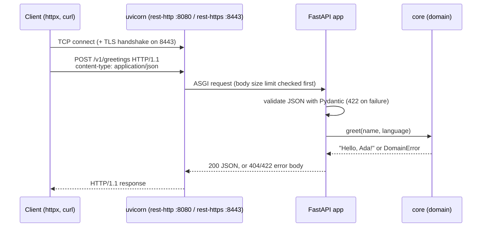
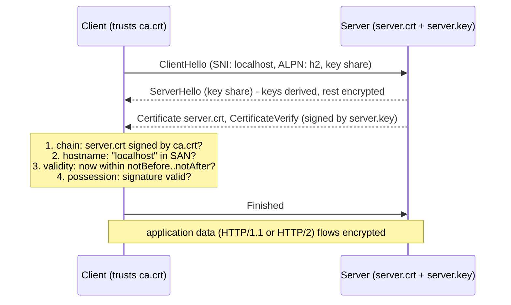
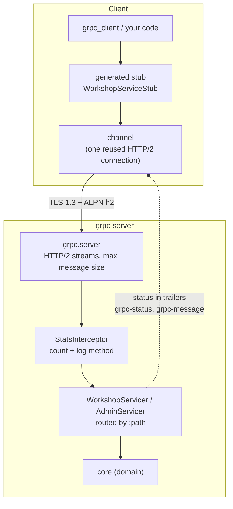
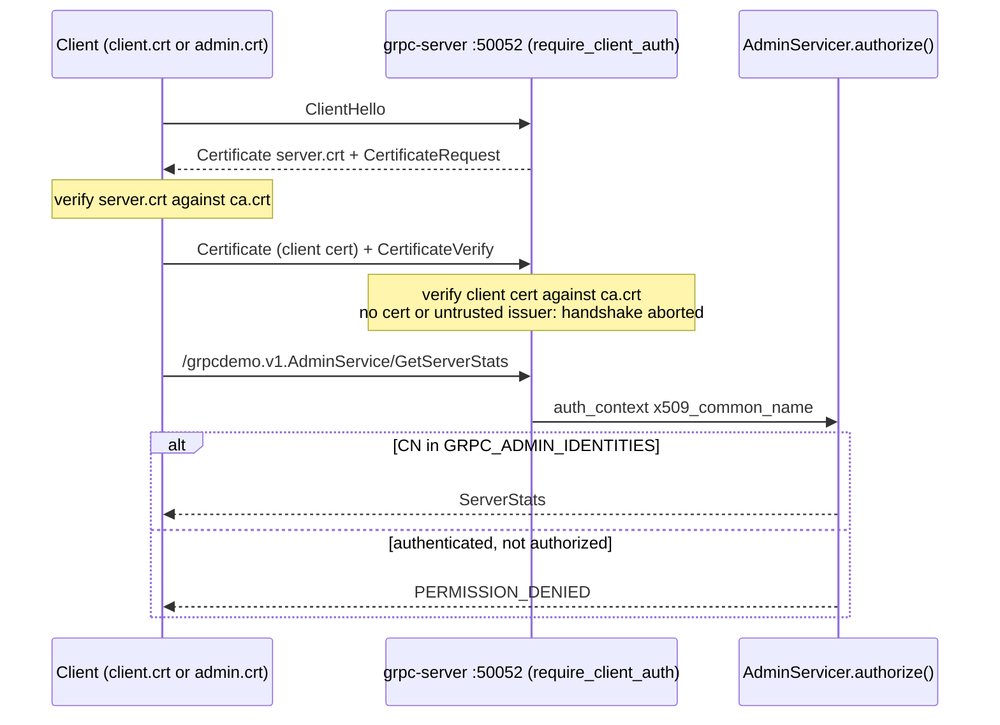
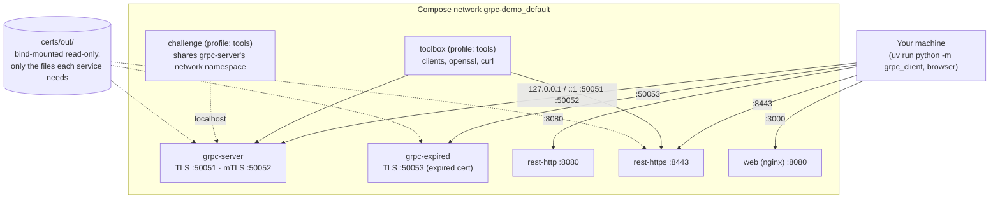

# Architecture

How the workshop is built, and why. For the security model see [security.md](security.md).

## Components

| Component | Code | Runs as | Purpose |
| --- | --- | --- | --- |
| Contract | `services/proto/grpcdemo/v1/workshop.proto` | - | the single source of truth for the gRPC API |
| Generated bindings | `services/generated/grpcdemo/v1/` | - | produced by `scripts/generate_proto.py`; never edited by hand; CI checks they match |
| Domain logic | `services/core/` | library | greetings, topics, stream logic; no gRPC, HTTP or TLS knowledge |
| gRPC server | `services/grpc_server/` | `grpc-server`, `grpc-expired` | `WorkshopService` (4 patterns), `AdminService` (mTLS + authorization), standard health service |
| REST API | `services/rest_api/` | `rest-http`, `rest-https` | the same unary operations as JSON over HTTP/1.1 |
| Shared infrastructure | `services/common/` | library | validated configuration (the only module that reads environment variables), TLS credential loading, logging |
| CLI client | `services/grpc_client/` | your terminal / `toolbox` | one subcommand per RPC, explained errors |
| Certificate lab | `certs/scripts/certs.py`, `certs/openssl/ca.cnf` | your terminal / `toolbox` | local CAs and certificates via OpenSSL |
| Final challenge | `challenge/` | your terminal / `challenge` | broken profiles, runner, checker |
| Examples | `examples/` | your terminal / `toolbox` | wire tap, TLS inspector, wire format, latency, multiplexing |
| Website | `frontend/` | `web` (nginx), Vercel | renders `workshop/*.md` and these docs |

## Request flows

### REST over HTTP/1.1

<!-- diagram: rest-flow -->

### TLS: handshake and trust

<!-- diagram: tls-trust -->

### gRPC over HTTP/2

<!-- diagram: grpc-flow -->

One HTTP/2 stream per call. Request and response messages travel as length-prefixed protobuf in `DATA` frames; the status travels in trailers. Deadlines travel as the `grpc-timeout` header; the servicers watch for cancellation (`context.add_callback`) and stop work early.

### Mutual TLS and authorization

<!-- diagram: mtls-flow -->

### Docker Compose topology

<!-- diagram: compose-topology -->

## Design decisions

- **One server process, several listeners.** TLS and mTLS ports share servicers, so the only variable between them is transport security. Plaintext is a third listener that is off by default and refused on non-loopback addresses.
- **Synchronous gRPC server with a thread pool.** Easiest to read for learners. Each streaming call holds a worker thread; `maximum_concurrent_rpcs` caps load so excess calls fail fast with `RESOURCE_EXHAUSTED` instead of queueing. An `asyncio` server (`grpc.aio`) would scale better for many long-lived streams.
- **Shared domain logic.** `core` is transport-agnostic so REST and gRPC comparisons are fair, and so error mapping lives at the edges (`grpc_server/errors.py`, `rest_api/app.py`).
- **Generated code committed, checked in CI.** Services run without `grpcio-tools`; `generate_proto.py --check` keeps the bindings honest.
- **Configuration in one module.** `services/common/config.py` reads and validates every variable at startup and names the variable in errors.
- **Certificates by script, not by library.** `certs.py` drives the real `openssl` CLI and prints each command, because the commands themselves are part of what learners take away.
- **No IP addresses in the server SAN.** Deliberate, to make hostname verification visible (chapter 09).
- **Health checks that exercise the real path.** `grpc-server`'s health check is a gRPC Health call over TLS with verification; `rest-https` fetches `/health` over verified HTTPS.
- **Static website.** The site is a static export: no server code, no API keys, deployable anywhere. It cannot and does not talk to the gRPC services (see below).

## Browsers and gRPC

Browser JavaScript cannot speak native gRPC: `fetch()` does not expose HTTP/2 framing or trailers, and browsers do not let pages control TLS client certificates per request. The standard workaround is **gRPC-Web**, a slightly different wire protocol that browsers can send, translated to gRPC by a proxy (Envoy, or a server library). This workshop's website therefore does not call the services; it teaches, and you run the clients in a terminal.

## Going further

- Replace the thread pool server with `grpc.aio` and compare streaming concurrency.
- Add server reflection (`grpcio-reflection`) and explore the API with `grpcurl`.
- Put Envoy in front for gRPC-Web, and call `SayHello` from the browser.
- Add OpenTelemetry tracing to see deadlines and retries across services (see [jars-demo/otel-demo](https://github.com/jars-demo/otel-demo) for a full observability workshop).
- Issue certificates with SPIFFE IDs in a URI SAN and authorize on those instead of the Common Name.
