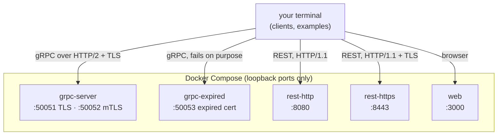

# 00 · Overview and Setup

> ⏱ 10 minutes · What you will build, what you need, and a running environment.

## Learning objectives

- Know what the workshop covers and in which order: HTTP → HTTPS → TLS → HTTP/2 → Protocol Buffers → gRPC → streaming → certificate validation → mutual TLS → troubleshooting.
- Have the complete environment running: a gRPC server, a REST API over HTTP and HTTPS, a server with an expired certificate, and this website.
- Know which commands you run in a terminal and what happens in the browser.

## Prerequisites

| Tool | Version | Needed for |
| --- | --- | --- |
| [Docker Desktop](https://docs.docker.com/get-docker/) (Windows/macOS) or Docker Engine + Compose v2 (Linux) | Compose 2.20+ | running the services |
| [uv](https://docs.astral.sh/uv/getting-started/installation/) | 0.5+ | the Python clients, examples and tests (uv installs Python 3.13 for you) |
| OpenSSL | 1.1.1 or 3.x | generating certificates. Windows: included with [Git for Windows](https://gitforwindows.org/). Without it, see the Docker alternative below. |
| Node.js | 22 | only if you want to build this website yourself |

You do not need a cloud account, an API key, or an internet connection after the first install.

> **Terminal or browser?** Every code block marked `bash`/`powershell` is something *you* type in a terminal, from the repository root. Nothing on this website runs commands on your machine. Unless a block says otherwise, the same command works in PowerShell, bash and zsh.

## Concept: what we are building

One small **Workshop Service** with two front doors:

- a **gRPC** API (`services/proto/grpcdemo/v1/workshop.proto`) with all four call patterns, and
- a **REST** API (FastAPI) exposing the same unary operations as JSON over HTTP.

Both call the same Python functions in `services/core/`, so when you compare them, the differences you see are the protocols', not the business logic's.



The certificates come from a **local educational certificate authority** that you generate yourself in `certs/out/`. They are never committed and must never be trusted outside this workshop.

## Exercise: start everything

### 1. Get the code and the Python environment

```bash
git clone https://github.com/jars-demo/grpc-demo.git
cd grpc-demo
uv sync
```

**Expected:** uv downloads Python 3.13 if needed, creates `.venv/`, and ends with a list of installed packages (`+ grpcio==1.84.0`, `+ fastapi==...` and so on).

### 2. Generate the certificates

```bash
uv run python certs/scripts/certs.py generate
```

**Expected:** each `openssl` command is printed as it runs, ending with:

```text
Done. 2 CAs and 5 certificates in certs/out
```

No OpenSSL? Build the toolbox image and generate them inside Docker instead:

```bash
docker compose --profile tools run --rm --no-deps toolbox python certs/scripts/certs.py generate
```

### 3. Start the stack

```bash
uv run python scripts/tasks.py up
```

**Expected:** Compose builds two images (`grpc-demo-service`, `grpc-demo-web`), starts five containers, waits until every health check passes, and lists them (the first build takes a few minutes; columns abridged):

```text
NAME                       SERVICE        STATUS                   PORTS
grpc-demo-grpc-expired-1   grpc-expired   Up 6 seconds (healthy)   127.0.0.1:50053->50053/tcp, [::1]:50053->50053/tcp
grpc-demo-grpc-server-1    grpc-server    Up 6 seconds (healthy)   127.0.0.1:50051-50052->50051-50052/tcp, [::1]:50051-50052->50051-50052/tcp
grpc-demo-rest-http-1      rest-http      Up 6 seconds (healthy)   127.0.0.1:8080->8080/tcp, [::1]:8080->8080/tcp
grpc-demo-rest-https-1     rest-https     Up 6 seconds (healthy)   127.0.0.1:8443->8443/tcp, [::1]:8443->8443/tcp
grpc-demo-web-1            web            Up 6 seconds (healthy)   127.0.0.1:3000->8080/tcp, [::1]:3000->8080/tcp
```

Open <http://localhost:3000> for this website, served from your own machine.

### 4. Prove it works

```bash
uv run python scripts/smoke_test.py
```

**Expected:** 21 lines starting with `PASS`, then `21/21 checks passed`. Some checks *expect* a failure (an untrusted CA, an expired certificate) and pass when the failure happens for the right reason. You may also see log lines starting with `I1016 ... Handshake failed` - that is gRPC's own logging of those deliberate failures.

## What just happened

`certs.py` created two certificate authorities (the workshop CA and a deliberately untrusted "rogue" CA) and five certificates. `tasks.py up` checked the certificates exist, then ran `docker compose up --build --wait`. Each container mounts only the certificate files it needs, read-only, and every port is published on loopback only. The `grpc-server` health check is itself a gRPC call over TLS with full certificate verification: "healthy" means a real client can connect.

## Common failure: `certificates missing`

```text
error: certificates missing (ca.crt, server.crt, server.key, expired-server.crt). Generate them first:
```

**Diagnose:** `uv run python certs/scripts/certs.py list` shows which files exist. **Fix:** run step 2. If `openssl` is not found, the error message lists how to install it per OS, or use the Docker command shown in step 2.

Another frequent one: `Bind for 127.0.0.1:8080 failed: port is already allocated`. Another program uses the port. Either stop it, or set a different host port in `.env` (copy `.env.example`; for example `REST_HTTP_HOST_PORT=18080`).

## Knowledge check

1. Which two interfaces does the Workshop Service expose, and why do they share `services/core/`?
2. Why are the ports published on `127.0.0.1` and `::1` only?
3. Is the workshop CA safe to add to your operating system's trust store?

<details>
<summary>Answers</summary>

1. gRPC and REST. Sharing the logic means any difference you observe comes from the protocol.
2. So nothing in the lab is reachable from other machines on your network.
3. No. Its private key sits unprotected in `certs/out/`; anyone who copies it could issue certificates your machine would trust.

</details>

## Done when

`uv run python scripts/smoke_test.py` ends with `21/21 checks passed`.

Next: [01 · How HTTP Works](01-how-http-works.md)
