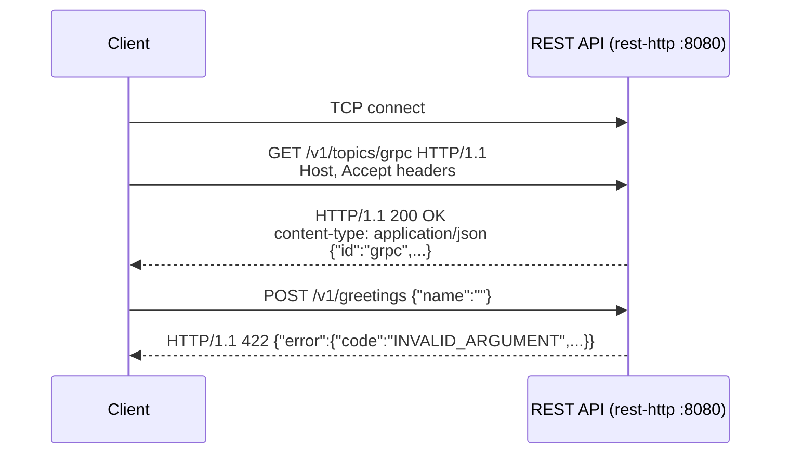

# 01 · How HTTP Works

> ⏱ 15 minutes · Requests, responses, methods, headers, status codes - read straight off the wire.

## Learning objectives

- Name the parts of an HTTP request (method, path, headers, body) and response (status, headers, body).
- Choose between `GET` and `POST`, and read the common status codes (200, 404, 413, 422, 500).
- See that HTTP/1.1 is plain text on the wire, and what that means without TLS.

## Prerequisites

Chapter 00 done: the stack is running.

## Concept

HTTP is a request/response protocol. The client opens a TCP connection and sends a **request**; the server sends back a **response**. In HTTP/1.1 both are text:

```text
POST /v1/greetings HTTP/1.1          <- method, path, version
Host: localhost:8080                 <- headers: metadata about the message
Content-Type: application/json
Content-Length: 15
                                     <- blank line: end of headers
{"name": "Ada"}                      <- body
```

```text
HTTP/1.1 200 OK                      <- version, status code, reason
content-type: application/json

{"message":"Hello, Ada!", ...}
```

- **Method** says what kind of action: `GET` reads and must not change anything; `POST` submits data.
- **Path** names the resource: `/v1/topics/grpc`.
- **Status code** class: `2xx` success, `4xx` the *client* must change the request, `5xx` the *server* failed.
- **Headers** carry metadata: content type, length, caching, authentication.



## Exercise

### 1. Make requests

```bash
uv run python examples/rest_client.py http://localhost:8080/v1/topics/grpc
uv run python examples/rest_client.py http://localhost:8080/v1/greetings --name Ada
```

**Expected:**

```text
HTTP/1.1 200 OK
content-type: application/json
content-length: 133

{
  "id": "grpc",
  "title": "gRPC",
  "summary": "Remote procedure calls over HTTP/2 with Protocol Buffers.",
  "layer": "application",
  "minutes": 20
}
```

and a greeting with `"transport_security": "http"`.

### 2. Make the server say no

```bash
uv run python examples/rest_client.py http://localhost:8080/v1/topics/nope
uv run python examples/rest_client.py http://localhost:8080/v1/greetings --name ""
```

**Expected:** `HTTP/1.1 404 Not Found` with `"code": "NOT_FOUND"`, then `HTTP/1.1 422 Unprocessable Content` with `"message": "name: String should have at least 1 character"`.

### 3. Read the raw bytes

Start the wire tap in a second terminal. It relays port 8090 to the REST API and prints everything that passes:

```bash
uv run python examples/wire_tap.py --listen 8090 --forward localhost:8080
```

Back in the first terminal, send the request through the tap:

```bash
uv run python examples/rest_client.py http://localhost:8090/v1/topics/grpc
```

**Expected** (in the tap's terminal; `..` stands for the `\r\n` line endings):

```text
[conn 1] client -> server 156 bytes | GET /v1/topics/grpc HTTP/1.1..Host: localhost:8090..Accept: */*..Accept-Encoding: gzip, deflate..Connection: keep-alive..User-Agent: python-httpx/0.28.1....
[conn 1] server -> client 300 bytes | HTTP/1.1 200 OK..date: Fri, 16 Oct 2026 13:08:43 GMT..content-length: 133..content-type: application/json..x-content-type-options: nosniff..cache-control: no-st…
```

Stop the tap with Ctrl+C.

### 4. Browse the API description

Open <http://localhost:8080/openapi.json> in your browser. FastAPI generates this OpenAPI description from the code: each path, method, request schema and possible error. (<http://localhost:8080/docs> renders it interactively; that page loads its JavaScript from a public CDN, so it needs internet access.)

## What just happened

Your request was readable text, and so was the response. Anything between you and the server - a Wi-Fi access point, a proxy, someone on the same network - could read it and could also *change* it. The status codes told you who had to act: 404 and 422 are client errors, so retrying the same request will not help.

## Common failure: `connection failed: [WinError 10061] ... actively refused it`

(On Linux/macOS: `Connection refused`.) Nothing listens on that port. **Diagnose:** `docker compose ps` - is `rest-http` up and healthy? Is the port in your URL 8080? **Fix:** `uv run python scripts/tasks.py up`, or correct the port.

## Knowledge check

1. A client receives `422`. Should it retry the identical request?
2. Which part of an HTTP/1.1 request tells the server how many body bytes follow?
3. What could an observer on the network learn from the tap output in step 3?

<details>
<summary>Answers</summary>

1. No. 4xx means the request itself must change.
2. The `Content-Length` header (or chunked transfer encoding).
3. Everything: the path, the headers, the user agent and the complete JSON body. Chapter 02 fixes that.

</details>

## Done when

You have seen a `200`, a `404` and a `422`, and read a raw HTTP/1.1 request in the wire tap.

Next: [02 · HTTPS and TLS](02-https-and-tls.md)
