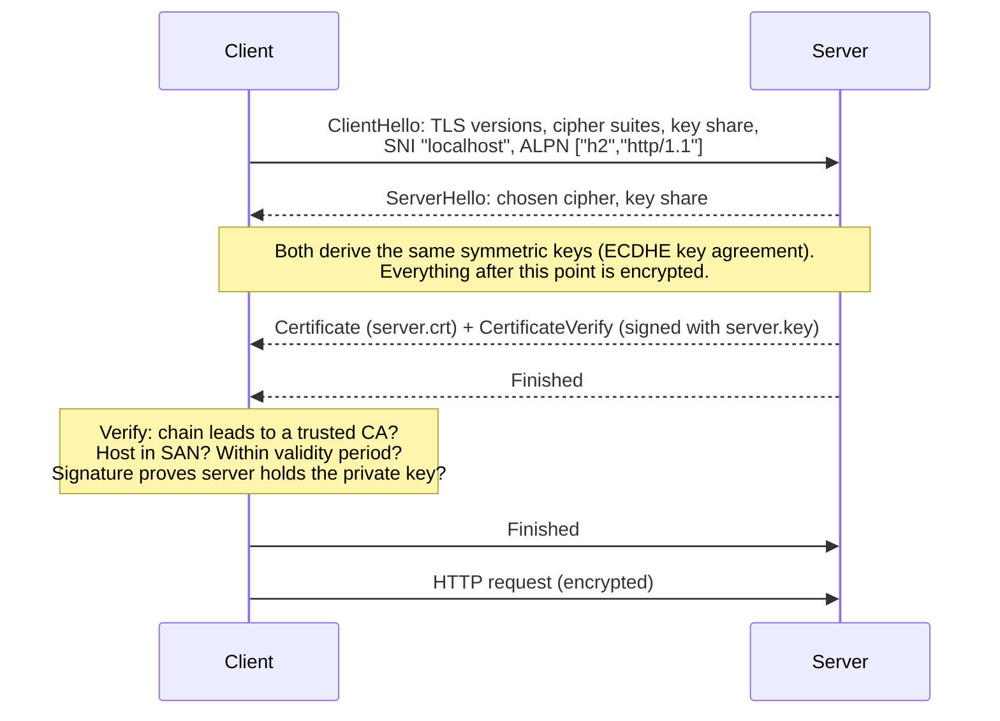
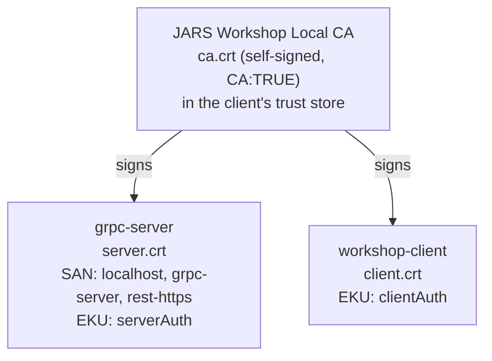

# 02 · HTTPS and TLS

> ⏱ 20 minutes · Encryption in transit, certificates, and why a client trusts a server.

## Learning objectives

- Explain what HTTPS is: HTTP sent inside a TLS connection.
- Describe the TLS handshake at a conceptual level: key agreement, certificate, verification.
- Distinguish public-key cryptography (used to authenticate and agree on keys) from symmetric encryption (used for the data).
- Explain chains of trust, Subject Alternative Names (SANs) and validity periods.
- Say what TLS protects and what it does not.

## Prerequisites

Chapter 01.

## Concept

**HTTPS is HTTP over TLS.** The HTTP messages are exactly the ones from chapter 01; TLS wraps them in an encrypted, integrity-protected channel. TLS (Transport Layer Security) provides three things:

1. **Confidentiality** - observers cannot read the data.
2. **Integrity** - nobody can change the data in transit without detection.
3. **Server authentication** - the client verifies it is talking to the server it intended, not an impostor.

### The handshake, conceptually (TLS 1.3)



- **Public-key cryptography** (here: elliptic-curve keys, P-256) is slow but solves two hard problems: two parties agree on a secret over a public network (key agreement), and a server proves it holds the private key matching its certificate (signature).
- **Symmetric encryption** (AES-GCM or ChaCha20-Poly1305) is fast and does the bulk work, using keys derived during the handshake.

### Certificates and the chain of trust

A certificate binds a **public key** to **names**, and is signed by an **issuer**. The client trusts it only if:

1. it can build a chain from the certificate to a **CA certificate it already trusts** (its "trust store");
2. the hostname it connected to appears in the certificate's **Subject Alternative Name** (SAN) list - the Common Name (CN) is not used for this by modern clients;
3. the current time is between **notBefore** and **notAfter**;
4. the server proves possession of the matching private key during the handshake.



Your operating system ships with public CAs. This workshop uses its own CA instead, and clients are told to trust it explicitly with `--ca certs/out/ca.crt`.

### What TLS does not do

- It does not hide **who you talk to**: IP addresses, ports and (by default) the server name in the ClientHello (SNI) are visible.
- It does not protect data **on the endpoints**: the server, logs and databases see plaintext.
- It does not **authenticate application users** or decide what they may do. That is authentication and authorization at the application layer (chapter 10).

## Exercise

### 1. Inspect the server certificate

```bash
uv run python certs/scripts/certs.py inspect server
```

**Expected** (serial and dates differ on your machine):

```text
subject=CN=grpc-server,O=JARS DEMO gRPC Workshop
issuer=CN=JARS Workshop Local CA,OU=Local educational CA - do not trust outside the workshop,O=JARS DEMO gRPC Workshop
serial=5D994313299D3ABBE480F2EE7D35C9DF
notBefore=Oct 16 12:49:09 2026 GMT
notAfter=Jan 14 12:49:09 2027 GMT
X509v3 Basic Constraints: critical
    CA:FALSE
X509v3 Key Usage: critical
    Digital Signature
X509v3 Extended Key Usage:
    TLS Web Server Authentication
X509v3 Subject Alternative Name:
    DNS:localhost, DNS:grpc-server, DNS:rest-https
```

### 2. Make an HTTPS request with verification

```bash
uv run python examples/rest_client.py https://localhost:8443/v1/greetings --name Ada --language fr
```

**Expected:** `HTTP/1.1 200 OK` and `"transport_security": "https"`. The client verified the server certificate against `certs/out/ca.crt`.

### 3. Watch the handshake result

```bash
uv run python examples/tls_inspect.py localhost 8443
```

**Expected:**

```text
connected to localhost:8443
  TLS version:  TLSv1.3
  cipher suite: TLS_AES_256_GCM_SHA384
  ALPN:         (none negotiated)
  subject CN:   grpc-server
  issuer CN:    JARS Workshop Local CA
  valid:        Oct 16 12:49:09 2026 GMT  ->  Jan 14 12:49:09 2027 GMT
  SAN:          localhost, grpc-server, rest-https
```

`ALPN (none negotiated)` means the server did not offer HTTP/2; the REST API speaks HTTP/1.1. Remember this for chapter 03.

### 4. Break trust on purpose

Give the clients the *rogue* CA as their trust anchor. It is a perfectly valid CA - it just did not issue this server's certificate:

```bash
uv run python examples/rest_client.py https://localhost:8443/health --ca certs/out/rogue-ca.crt
uv run python examples/tls_inspect.py localhost 8443 --ca certs/out/rogue-ca.crt
```

**Expected:**

```text
connection failed: [SSL: CERTIFICATE_VERIFY_FAILED] certificate verify failed: unable to get local issuer certificate (_ssl.c:1032)
certificate verification failed: unable to get local issuer certificate (code 20)
```

### 5. Optional: curl

curl prints the TLS details with `-v`. On Windows use `curl.exe` (in Windows PowerShell 5.1, `curl` is an alias for a different command) and add `--ssl-revoke-best-effort`: Windows' TLS library tries to check revocation, and a local CA publishes no revocation list. That flag only relaxes the revocation lookup; chain and hostname verification stay on.

```powershell
curl.exe --ssl-revoke-best-effort --cacert certs/out/ca.crt https://localhost:8443/v1/topics/tls
```

```bash
curl --cacert certs/out/ca.crt https://localhost:8443/v1/topics/tls
```

Or the same, identically on every OS, from the toolbox container:

```bash
docker compose --profile tools run --rm toolbox curl -sS --cacert certs/out/ca.crt https://rest-https:8443/v1/topics/tls
```

## What just happened

The client had one trust anchor, `ca.crt`. The server presented `server.crt`, signed by that CA, listing `localhost` in its SAN, within its validity period, and proved it holds `server.key`. All four checks passed, so the client sent the HTTP request inside the encrypted channel. With `rogue-ca.crt` as the trust anchor, step 1 of verification - building a chain - failed, and the client refused to continue. That refusal is the protection: it is what stops an impostor.

## Common failure: "Just turn verification off"

Search engines are full of advice like `curl -k`, `verify=False` or "accept all certificates". Do not follow it. These make the error go away by removing the authentication that TLS exists to provide: an attacker in the middle can then present any certificate. In this repository no client has such an option, and a test fails if one is added. When verification fails, the error tells you which check failed; fix the trust store, the hostname or the certificate.

## Knowledge check

1. Is HTTP/2 the same thing as HTTPS?
2. Which certificate field must contain the hostname you connect to?
3. Why does TLS use both public-key and symmetric cryptography?
4. After a successful TLS handshake, does the server know who the *user* is?

<details>
<summary>Answers</summary>

1. No. HTTPS means HTTP over TLS (any HTTP version). HTTP/2 is a protocol version, usable with or without TLS.
2. The Subject Alternative Name (SAN).
3. Public-key operations authenticate and agree on keys but are slow; symmetric ciphers are fast for the data.
4. No. Server-only TLS authenticates the server to the client. User identity needs application authentication (or client certificates, chapter 10).

</details>

## Done when

You have inspected `server.crt`, made a verified HTTPS request, and seen verification fail with the rogue CA.

Next: [03 · HTTP/2 Fundamentals](03-http2-fundamentals.md)
