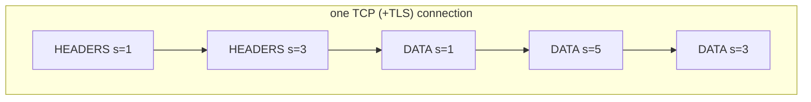

# 03 · HTTP/2 Fundamentals

> ⏱ 15 minutes · Binary frames, streams, and many calls over one connection.

## Learning objectives

- Explain how HTTP/2 differs from HTTP/1.1: binary framing, streams, multiplexing, header compression.
- Read real HTTP/2 frames: `SETTINGS`, `HEADERS`, `DATA`, `WINDOW_UPDATE`, `PING`.
- Explain how a client and server agree to use HTTP/2 (ALPN with TLS, or prior knowledge without).

## Prerequisites

Chapters 01-02. Three terminals (server, wire tap, client).

## Concept

HTTP/2 keeps HTTP's meaning - methods, paths, headers, status codes - but changes how it travels:

| | HTTP/1.1 | HTTP/2 |
| --- | --- | --- |
| Encoding | text lines | binary **frames** with a 9-byte header |
| Concurrency | one request at a time per connection (browsers open ~6 connections) | many **streams** on one connection, frames interleaved |
| Headers | repeated in full as text | compressed with **HPACK** |
| Version agreement | none needed | **ALPN** `h2` in the TLS handshake, or "prior knowledge" in plaintext |

Every frame header carries a **length**, a **type**, **flags** and a **stream id**. A request is a `HEADERS` frame (its `:method`, `:path`, `:authority` pseudo-headers plus normal headers) and optionally `DATA` frames, all with the same stream id. Client-started streams use odd ids: 1, 3, 5, ...



**HTTP/2 is not HTTPS.** It is a protocol version. Browsers only use it over TLS, but it can run in plaintext (called h2c), which is what makes the frames visible in this exercise.

## Exercise

### 1. Start a plaintext gRPC server and the wire tap

gRPC speaks HTTP/2, so the workshop's gRPC server is a convenient HTTP/2 peer. Terminal 1:

```bash
uv run python -m grpc_server --plaintext-only
```

**Expected:** `listening: plaintext localhost:50050  (plaintext: loopback only, for the introductory exercise)`

Terminal 2:

```bash
uv run python examples/wire_tap.py --listen 50060 --forward localhost:50050
```

### 2. One call, frame by frame

Terminal 3:

```bash
uv run python -m grpc_client --plaintext --target localhost:50060 hello --name Ada
```

**Expected** in the tap's terminal (abridged):

```text
[conn 1] client -> server 82 bytes | PRI * HTTP/2.0....SM….$………….@…@….@………..?..
[conn 1]   connection preface: PRI * HTTP/2.0 (client says: I speak HTTP/2)
[conn 1]   frame SETTINGS      stream=0   len=36    -
[conn 1]   frame WINDOW_UPDATE stream=0   len=4     -
[conn 1] server -> client 46 bytes | ……..@…@….@………..?..
[conn 1]   frame SETTINGS      stream=0   len=24    -
...
[conn 1] client -> server 299 bytes | …....@.:path%/grpcdemo.v1.WorkshopService/SayHello@.:authority.localhost:50060..@.content-type.application/grpc@.te.trailers...
[conn 1]   frame HEADERS       stream=1   len=245   END_HEADERS
[conn 1]   frame DATA          stream=1   len=10    END_STREAM/ACK  gRPC message 5 bytes: '..Ada'
...
[conn 1]   frame HEADERS       stream=1   len=78    END_HEADERS
[conn 1]   frame DATA          stream=1   len=43    -  gRPC message 38 bytes: '..Hello, Ada!……….plaintext'
[conn 1]   frame HEADERS       stream=1   len=30    END_STREAM/ACK|END_HEADERS
```

Read it top to bottom: the client's **preface** and **SETTINGS**; the server's SETTINGS and acknowledgements; the request as a **HEADERS** frame on stream 1 (`:path` names the RPC) and a **DATA** frame carrying the 5-byte request; the response HEADERS, DATA, and a final HEADERS frame - the **trailers**, where gRPC puts `grpc-status: 0`. Flag `0x1` means `END_STREAM` on DATA/HEADERS frames and `ACK` on SETTINGS/PING frames.

### 3. Three calls, one connection

```bash
uv run python examples/multiplex.py --plaintext --target localhost:50060
```

**Expected** (the client side; timings vary):

```text
[ 0.02s] call-1 event #1 http
[ 0.02s] call-3 event #1 http
[ 0.02s] call-2 event #1 http
[ 0.18s] call-1 event #2 tls
[ 0.33s] call-2 event #2 tls
[ 0.33s] call-1 event #3 http2
[ 0.47s] call-3 event #2 tls
[ 0.65s] call-2 event #3 http2
[ 0.93s] call-3 event #3 http2
three calls, one channel, 0.93s total
```

In the tap: exactly one new `client connected` line, and `HEADERS`/`DATA` frames for **streams 1, 3 and 5** interleaved on that one connection.

### 4. How HTTP/2 is negotiated over TLS

With TLS, client and server agree on the protocol inside the handshake (ALPN). Compare the gRPC port with the REST port from chapter 02:

```bash
uv run python examples/tls_inspect.py localhost 50051
```

**Expected:** `ALPN:         h2` - the gRPC server chose HTTP/2. The REST API (uvicorn) showed `(none negotiated)`: it only speaks HTTP/1.1.

Stop the server and the tap (Ctrl+C) when done.

## What just happened

The same HTTP concepts - a method (`POST`, implied by gRPC), a path, headers, a body, a status - travelled as binary frames. One TCP connection carried several independent calls at once, each on its own stream, with no call waiting for another to finish. That is multiplexing, and it is why a gRPC channel is meant to be created once and reused.

## Common failure: speaking the wrong protocol

Point the plaintext client at the TLS port:

```bash
uv run python -m grpc_client --plaintext --target localhost:50051 hello
```

**Expected:** `RPC failed: UNAVAILABLE` with `End of TCP stream` (or `Connection aborted` on Windows). The server expected a TLS ClientHello and received the HTTP/2 preface, so it closed the connection. The reverse (TLS to a plaintext port) shows `WRONG_VERSION_NUMBER`: the client expected a TLS record and got HTTP/2 bytes. **Diagnose:** check the port and whether the listener is TLS.

## Knowledge check

1. Which frame carries a request's path?
2. Two calls run at once on one gRPC channel. How does the server tell their frames apart?
3. How does a TLS client learn that the server speaks HTTP/2?

<details>
<summary>Answers</summary>

1. `HEADERS`, as the `:path` pseudo-header.
2. By the stream id in each frame header.
3. ALPN: the client offers `h2` in its ClientHello; the server selects it.

</details>

## Done when

You have seen a `HEADERS` and a `DATA` frame for the same stream, and three streams sharing one connection.

Next: [04 · Protocol Buffers](04-protocol-buffers.md)
