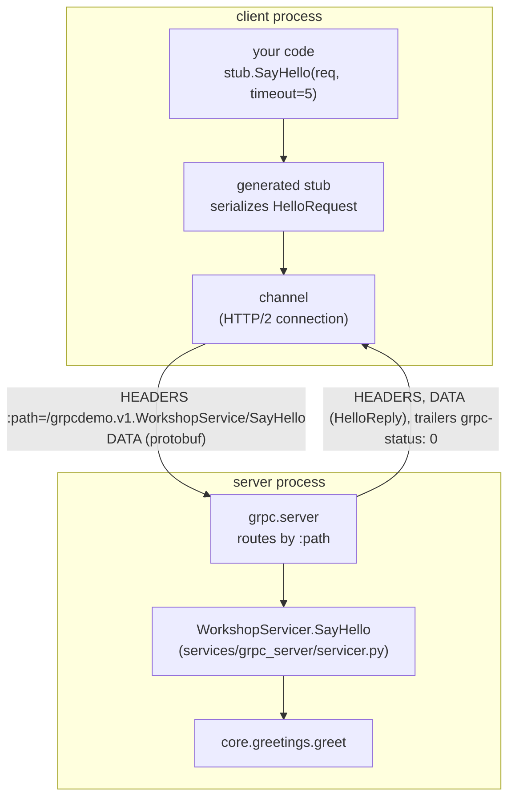

# 05 · Your First gRPC Call

> ⏱ 15 minutes · A unary RPC end to end: stub, channel, servicer, status.

## Learning objectives

- Make a unary gRPC call and read the reply.
- Follow a call through the code: client stub → channel → HTTP/2 → server → servicer → reply.
- Read gRPC status codes and how domain errors map onto them.
- Know why this chapter is the only one that uses plaintext.

## Prerequisites

Chapters 03-04. Two terminals.

## Concept



- A **channel** is a long-lived, reusable connection (or pool) to a target. Create one, reuse it.
- A **stub** is generated from the `.proto`: one method per RPC, which serializes the request and deserializes the reply.
- A **servicer** is your implementation of the generated base class.
- Every call ends with a **status**: `OK`, or a code such as `INVALID_ARGUMENT`, `NOT_FOUND`, `DEADLINE_EXCEEDED`, `UNAVAILABLE`.
- `timeout=5` sets a **deadline**: the time by which the client stops waiting. It is sent to the server too.

**Why plaintext here?** To see one moving part at a time. The plaintext listener only accepts `localhost` binding - the server refuses to start it on any other address (`services/common/config.py`), and the client refuses plaintext to non-loopback targets. From chapter 07 onward everything uses TLS.

## Exercise

### 1. Start the server with a plaintext listener

Terminal 1:

```bash
uv run python -m grpc_server --plaintext-only
```

### 2. Call it

Terminal 2:

```bash
uv run python -m grpc_client --plaintext --target localhost:50050 hello --name Ada
```

**Expected** (the timestamp differs):

```text
Hello, Ada!
  transport security: plaintext
  served at:          12:51:35.811 UTC
  status:             OK
```

`transport security: plaintext` is reported by the *server*, from the connection itself (`context.auth_context()`), not from anything the client claims.

### 3. More unary calls and errors

```bash
uv run python -m grpc_client --plaintext --target localhost:50050 topics --layer security
uv run python -m grpc_client --plaintext --target localhost:50050 topic nope
uv run python -m grpc_client --plaintext --target localhost:50050 hello --name ""
```

**Expected:**

```text
tls        security        20 min  HTTPS and TLS
mtls       security        20 min  Mutual TLS
```

```text
RPC failed: NOT_FOUND
  details: topic 'nope' does not exist
  meaning: The requested item does not exist. (REST: 404)
```

```text
RPC failed: INVALID_ARGUMENT
  details: name must not be empty
  meaning: The server rejected the request content. Fix the request; retrying will not help. (REST: 400/422)
```

### 4. Read the code

Open these side by side and find each step of the diagram:

- `services/grpc_client/calls.py` - `hello()`: builds `pb.HelloRequest`, calls `SayHello.with_call(..., timeout=deadline)`.
- `services/grpc_server/servicer.py` - `SayHello()`: validates, calls `core.greetings.greet`, returns `pb.HelloReply`.
- `services/grpc_server/errors.py` - maps `core.errors.NotFound` to `grpc.StatusCode.NOT_FOUND`.

### 5. Without Python on your machine

The same round trip, in one process, inside the toolbox container:

```bash
docker compose --profile tools run --rm toolbox python examples/plaintext_loopback.py
```

**Expected:**

```text
server: listening on 127.0.0.1:61271 (plaintext, loopback only)
client: SayHello(request.name='loopback')
client: reply.message='Hello, loopback!'
client: reply.transport_security='plaintext'
client: request is 10 bytes on the wire as protobuf
server: stopped
```

Keep the plaintext server running for chapter 06, or stop it with Ctrl+C.

## What just happened

You called a function on another process as if it were local. The stub turned your arguments into protobuf bytes, the channel sent them as an HTTP/2 request whose path named the method, and the server routed that path to your servicer. Errors came back as a status code plus a message, in the HTTP/2 trailers, regardless of whether the server code raised a domain error or the transport failed.

## Common failure: `refusing plaintext to 'example.com'`

```bash
uv run python -m grpc_client --plaintext --target example.com:50050 hello
```

```text
error: refusing plaintext to 'example.com': plaintext is only for the loopback exercise in chapter 05. Remove --plaintext to use TLS.
```

That is a guard rail, not a bug. Unencrypted gRPC across a network exposes every request (chapter 01's tap showed you what that looks like). The server has the same rule: `GRPC_PLAINTEXT_PORT` with `GRPC_BIND_HOST=0.0.0.0` fails at startup with `plaintext gRPC is only allowed on a loopback address`.

## Knowledge check

1. What does the server use to decide which servicer method handles a call?
2. Your call fails with `INVALID_ARGUMENT`. Should the client retry it?
3. Where does the gRPC status travel in the HTTP/2 response?

<details>
<summary>Answers</summary>

1. The HTTP/2 `:path`, `/grpcdemo.v1.WorkshopService/SayHello`.
2. No - the request content is wrong; retrying sends the same bad request.
3. In the trailers: the final `HEADERS` frame, as `grpc-status` and `grpc-message`.

</details>

## Done when

You have received `Hello, Ada!` with status `OK`, and triggered `NOT_FOUND` and `INVALID_ARGUMENT`.

Next: [06 · REST vs gRPC](06-rest-vs-grpc.md)
