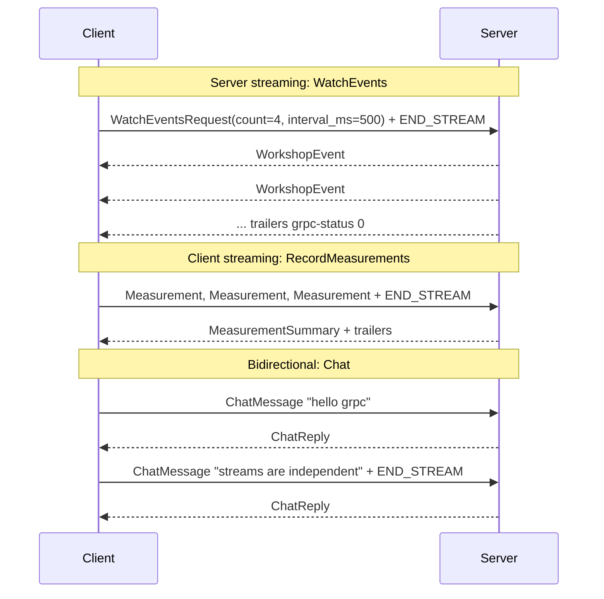

# 07 · Streaming RPCs

> ⏱ 20 minutes · Server streaming, client streaming and bidirectional streaming - for real.

## Learning objectives

- Use and explain all four gRPC interaction patterns.
- Show that streamed messages arrive incrementally, not all at the end.
- Stop a stream early with a deadline or cancellation, and know what the server does then.

## Prerequisites

Chapters 05-06. The stack is running. From this chapter on, the client uses its default: **TLS to `localhost:50051`**, the Docker server, trusting `certs/out/ca.crt`. Chapter 08 explains that setup.

## Concept

| Pattern | Request | Response | Workshop RPC | Typical use |
| --- | --- | --- | --- | --- |
| Unary | 1 | 1 | `SayHello` | most calls |
| Server streaming | 1 | many | `WatchEvents` | feeds, progress, large result sets |
| Client streaming | many | 1 | `RecordMeasurements` | uploads, batched telemetry |
| Bidirectional | many | many | `Chat` | interactive sessions, games, sync |

All four are one HTTP/2 stream. Each protobuf message is a length-prefixed chunk inside `DATA` frames; either side **half-closes** its direction (`END_STREAM`) when done. In bidirectional streaming the two directions are independent: the server may reply before the client has finished sending.



## Exercise

### 1. Server streaming

```bash
uv run python -m grpc_client watch --count 4 --interval-ms 500
```

**Expected:**

```text
[  0.01s] #1  http       Now covering: How HTTP works
[  0.51s] #2  tls        Now covering: HTTPS and TLS
[  1.01s] #3  http2      Now covering: HTTP/2
[  1.51s] #4  protobuf   Now covering: Protocol Buffers
stream completed: OK
```

The timestamps prove each event is delivered when produced, not batched at the end. Server code: `WatchEvents` in `services/grpc_server/servicer.py` is a Python generator; each `yield` sends one message.

### 2. Client streaming

```bash
uv run python -m grpc_client record 12 15.5 9
uv run python -m grpc_client record --measure-hello 20
```

**Expected** (the second line's numbers are measured on your machine):

```text
count=3 min=9.00ms p50=12.00ms mean=12.17ms max=15.50ms
labels: manual
count=20 min=0.92ms p50=1.30ms mean=1.80ms max=8.66ms
labels: say-hello
```

The second command times 20 real `SayHello` round trips and then streams those latencies to the server, which summarizes them only after the client half-closes.

### 3. Bidirectional streaming

```bash
uv run python -m grpc_client chat "hello grpc" "streams are independent" --pause-ms 300
```

**Expected:**

```text
[  0.30s] #1 'hello grpc' -> reversed 'cprg olleh' (2 words)
[  0.60s] #2 'streams are independent' -> reversed 'tnednepedni era smaerts' (3 words)
stream completed: OK
```

Reply #1 arrives at 0.30 s, *before* message #2 has been sent - the server answers while the client's direction is still open. Interactive version: run `uv run python -m grpc_client chat` with no messages, type lines, and press Ctrl+Z then Enter (Windows) or Ctrl+D (macOS/Linux) to half-close.

### 4. Cut a stream short with a deadline

```bash
uv run python -m grpc_client --deadline 1 watch --count 10 --interval-ms 400
```

**Expected:**

```text
[  0.01s] #1  http       Now covering: How HTTP works
[  0.41s] #2  tls        Now covering: HTTPS and TLS
[  0.81s] #3  http2      Now covering: HTTP/2
RPC failed: DEADLINE_EXCEEDED
  details: Deadline Exceeded
```

The deadline covers the **whole** stream, not each message. On the server, `_Lifetime.wait()` notices the call has ended and stops producing events instead of computing seven more that nobody will read.

## What just happened

Every pattern used one HTTP/2 stream on the same kind of connection; only the number of messages in each direction differed. The server learned that a call ended (normally, by deadline, or by cancellation) through `context.add_callback`, and stopped work - the same mechanism that makes deadlines useful for protecting servers, not just clients.

## Common failure: `INVALID_ARGUMENT: send at least one measurement`

```bash
uv run python -m grpc_client record
```

Client streaming with zero messages is valid gRPC, but this service requires at least one sample, and says so with `INVALID_ARGUMENT`. **Diagnose:** the `details` text names the rule. **Fix:** send values or `--measure-hello N`.

## Knowledge check

1. In `WatchEvents`, what decides when the stream ends normally?
2. Does a deadline of 1 s on a streaming call mean "each message within 1 s"?
3. What makes `Chat` *bidirectional* rather than "client streaming followed by server streaming"?

<details>
<summary>Answers</summary>

1. The server: the generator returns after `count` events, which sends the trailers.
2. No. It is the deadline for the entire call.
3. Replies can arrive while the client is still sending; the two directions progress independently.

</details>

## Done when

You have run all three streaming commands and seen a stream end with `DEADLINE_EXCEEDED` partway through.

Next: [08 · Enable TLS](08-enable-tls.md)
