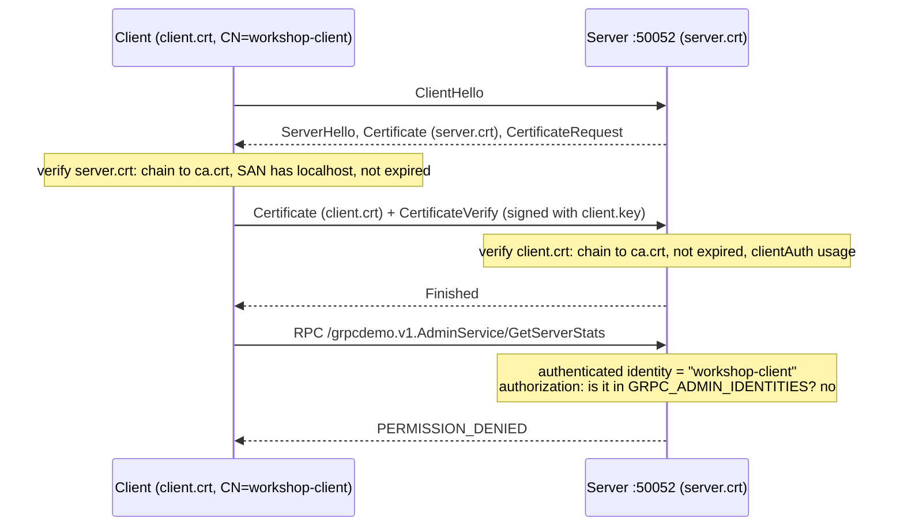

# 10 · Mutual TLS

> ⏱ 15 minutes · The client proves its identity too - and identity is still not permission.

## Learning objectives

- Configure mutual TLS: the server requires and verifies a client certificate.
- Diagnose a missing or untrusted client certificate using the *server's* log.
- Separate four ideas: encryption, server authentication, client authentication, authorization.

## Prerequisites

Chapters 08-09. The stack is running.

## Concept

In ordinary TLS only the server presents a certificate. In **mutual TLS** (mTLS) the server also asks the client for one, and verifies it against a CA *the server* trusts:

```python
grpc.ssl_server_credentials(
    [(server_key, server_cert)],
    root_certificates=client_ca,  # who may sign client certificates
    require_client_auth=True,  # no certificate, no connection
)
```

```python
grpc.ssl_channel_credentials(
    root_certificates=ca,  # who may sign the server certificate
    private_key=client_key,
    certificate_chain=client_cert,
)
```



| Property | Provided by |
| --- | --- |
| Encryption and integrity | TLS |
| Server authentication | TLS: server certificate verified by the client |
| Client authentication | mTLS: client certificate verified by the server |
| **Authorization** | **your application**: may *this* identity do *this* action? |

A certificate from a trusted CA answers "who are you?". It does not answer "what may you do?". In this workshop every client certificate is signed by the same CA, yet only `workshop-admin` may call `AdminService` (`services/grpc_server/admin.py`).

## Exercise

### 1. Connect with a client certificate

```bash
uv run python -m grpc_client --target localhost:50052 --cert certs/out/client.crt --key certs/out/client.key hello
```

**Expected:**

```text
Hello, workshop!
  transport security: mtls
  client identity:    workshop-client
  served at:          12:51:37.256 UTC
  status:             OK
```

The server read `workshop-client` from the verified certificate's Common Name.

### 2. No certificate

```bash
uv run python -m grpc_client --target localhost:50052 hello
```

**Expected:** `RPC failed: UNAVAILABLE` with `End of TCP stream` (Linux/macOS) or `Connection aborted` (Windows) in the details. The client learns only that the server hung up. The reason is on the other side:

```bash
docker compose logs grpc-server --since 1m
```

**Expected** (among the lines):

```text
grpc-server-1  | I1016 13:06:33.148238      11 ssl_transport_security.cc:2530] Handshake failed with error SSL_ERROR_SSL: error:100000c0:SSL routines:OPENSSL_internal:PEER_DID_NOT_RETURN_A_CERTIFICATE: Invalid certificate verification context
```

### 3. A certificate from the wrong CA

`rogue-client.crt` has **the same Common Name**, `workshop-client`, but was signed by the rogue CA:

```bash
uv run python -m grpc_client --target localhost:50052 --cert certs/out/rogue-client.crt --key certs/out/rogue-client.key hello
docker compose logs grpc-server --since 1m
```

**Expected:** `UNAVAILABLE` on the client; the server log shows `CERTIFICATE_VERIFY_FAILED: unable to get local issuer certificate`. A name inside a certificate means nothing until the signature chain is verified.

### 4. Authenticated is not authorized

```bash
uv run python -m grpc_client --target localhost:50052 --cert certs/out/client.crt --key certs/out/client.key stats
uv run python -m grpc_client --target localhost:50052 --cert certs/out/admin.crt --key certs/out/admin.key stats
uv run python -m grpc_client stats
```

**Expected:**

```text
RPC failed: PERMISSION_DENIED
  details: identity 'workshop-client' is authenticated but not authorized for AdminService
  meaning: The caller is authenticated but not allowed to do this. Authentication is not authorization. (REST: 403)
```

```text
caller: workshop-admin
uptime: 7s
calls by method:
       2  /grpcdemo.v1.AdminService/GetServerStats
       1  /grpcdemo.v1.WorkshopService/SayHello
```

(your counts and uptime will differ), and for the plain TLS port, which never asks for a client certificate:

```text
RPC failed: UNAUTHENTICATED
  details: AdminService requires a client certificate: connect to the mutual TLS port
```

## What just happened

On port 50052 the handshake itself enforced "has a certificate from the workshop CA": connections without one never reached the application. Behind the handshake, `authorize()` turned the verified identity into a decision. `UNAUTHENTICATED` (we do not know who you are) and `PERMISSION_DENIED` (we know, and the answer is no) are different statuses for a reason - they need different fixes.

## Common failure: trusting the CA as the access policy

"Only our services have certificates from our CA, so anything with one may do anything." That holds until a low-privilege service is compromised, or someone issues a certificate for a new tool. Then every holder of any certificate has full access. **Fix:** authorize per identity and per operation, as `AdminService` does, and keep the identity list in configuration (`GRPC_ADMIN_IDENTITIES`).

## Knowledge check

1. Which side verifies the client certificate, and against what?
2. Why does the client see only "End of TCP stream" when its certificate is rejected?
3. A caller gets `PERMISSION_DENIED`. Will a different CA help?
4. What does mTLS *not* tell you about a request?

<details>
<summary>Answers</summary>

1. The server, against the CA in its `root_certificates` (`GRPC_CLIENT_CA_FILE`).
2. The server aborts the handshake; TLS alerts carry little detail, and gRPC reports the closed connection. The precise reason is logged on the server.
3. No. Authentication succeeded; the identity lacks permission. Use an authorized identity or change the policy.
4. Whether the action is allowed, which end user (if any) is behind the calling service, or whether the payload is valid.

</details>

## Done when

You have made an mTLS call that shows `client identity: workshop-client`, found `PEER_DID_NOT_RETURN_A_CERTIFICATE` in the server log, and seen both `PERMISSION_DENIED` and a successful `stats` call.

Next: [11 · Debugging Clinic](11-debugging-clinic.md)
