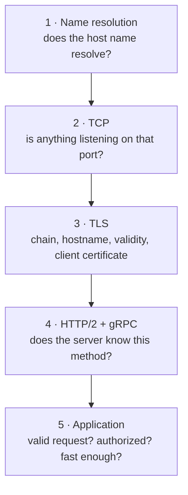

# 11 · Debugging Clinic

> ⏱ 15 minutes · A method for connection failures, and a reference of real errors with their causes.

## Learning objectives

- Diagnose a failing gRPC call layer by layer: name resolution, TCP, TLS, HTTP/2, application.
- Use the status code to pick the layer and the `details` text to find the cause.
- Know when the answer is in the *other* side's log.

## Prerequisites

Chapters 05-10. The stack is running.

## Concept: work from the bottom up



1. **Read the status code.** `UNAVAILABLE` means no usable connection (layers 1-3). `UNIMPLEMENTED` is layer 4. `INVALID_ARGUMENT`, `NOT_FOUND`, `PERMISSION_DENIED`, `UNAUTHENTICATED`, `DEADLINE_EXCEEDED` come from layer 5 (or from the deadline you set).
2. **Read the details to the end.** `failed to connect to all addresses; last error: ...` is a preamble; the reason follows.
3. **Look at the other side.** A server that rejects your certificate only tells *its own* log why: `docker compose logs grpc-server --since 5m`.
4. **Inspect, don't guess.** `certs.py inspect`, `tls_inspect.py`, `docker compose ps`.
5. **Change one thing**, then re-run the exact same command.

## Reference: real errors and their causes

All of these were produced by this repository's client (`python -m grpc_client`); the `meaning` and `hint` lines come from `services/grpc_client/diagnose.py`.

| Status | Text in `details` | Layer | Cause | Look at |
| --- | --- | --- | --- | --- |
| UNAVAILABLE | `errors resolving grpc-server:50051 ... No such host is known` | 1 | name not resolvable here | Compose names only resolve inside Compose; use `localhost` |
| UNAVAILABLE | `Connection refused` | 2 | nothing listening | `docker compose ps`, the port number |
| UNAVAILABLE | `CERTIFICATE_VERIFY_FAILED: unable to get local issuer certificate` | 3 | client trusts the wrong CA | `--ca`; `certs.py inspect server` (issuer) |
| UNAVAILABLE | `Hostname Verification Check failed` | 3 | target host not in SAN | `certs.py inspect server` (SAN) |
| UNAVAILABLE | `certificate has expired` | 3 | server certificate out of date | `certs.py list`; rotate |
| UNAVAILABLE | `End of TCP stream` / `Connection aborted` | 3 | server rejected the handshake: no or untrusted client certificate, or plaintext to a TLS port | **server log** |
| UNAVAILABLE | `WRONG_VERSION_NUMBER` | 3 | TLS client, plaintext server | port, `--plaintext` |
| UNIMPLEMENTED | `Method not found!` | 4 | client and server disagree about the contract | package/service/method name, `.proto` version |
| UNAUTHENTICATED | `requires a client certificate` | 5 | no client identity | use the mTLS port with `--cert/--key` |
| PERMISSION_DENIED | `is authenticated but not authorized` | 5 | identity lacks permission | policy, identity used |
| DEADLINE_EXCEEDED | `Deadline Exceeded` | 5 | deadline shorter than the work | server latency, deadline value |
| RESOURCE_EXHAUSTED | `Received message larger than max` | 5 | message over `GRPC_MAX_MESSAGE_BYTES` | payload size |

## Exercise: five cases

Run each command, classify the layer from the status and details *before* reading the explanation, then check.

### Case 1

```bash
uv run python -m grpc_client --target grpc-server:50051 hello
```

**Observed:**

```text
RPC failed: UNAVAILABLE
  details: errors resolving grpc-server:50051: [field:hostname lookup error:Address lookup failed for grpc-server:50051 os_error: UNAVAILABLE:getaddrinfo: WSA Error (No such host is known.
 -- 11001)]
```

(macOS/Linux word it as `nodename nor servname provided` or `Name or service not known`.) **Layer 1.** `grpc-server` is a name on the Compose network. From the toolbox container it works: `docker compose --profile tools run --rm toolbox python -m grpc_client --target grpc-server:50051 hello`.

### Case 2

```bash
docker compose stop grpc-server
uv run python -m grpc_client hello
docker compose start grpc-server
```

**Observed:** `UNAVAILABLE ... Connection refused` and the hint `Nothing is listening at that address and port`. **Layer 2.** After `start`, wait a few seconds (`docker compose ps` shows `healthy`) and the call works again.

### Case 3

```bash
uv run python examples/contract_mismatch.py
```

**Observed:**

```text
calling /grpcdemo.v2.WorkshopService/SayHello on localhost:50051
status:  UNIMPLEMENTED
details: Method not found!
```

**Layer 4.** TLS and HTTP/2 worked; the server has no handler for that `:path`. In real systems this means a client built from a newer (or different) `.proto` than the server.

### Case 4

```bash
uv run python -m grpc_client --target localhost:50052 --cert certs/out/client.crt hello
```

**Observed:** `error: mutual TLS needs both --cert and --key` (exit code 2). **Not a network error at all**: the client validated its own configuration before connecting. Configuration errors exit with code 2, RPC failures with code 1.

### Case 5

```bash
uv run python -m grpc_client --target localhost:50052 hello
docker compose logs grpc-server --since 1m
```

**Observed:** client: `UNAVAILABLE ... End of TCP stream` (or `Connection aborted`); server log: `PEER_DID_NOT_RETURN_A_CERTIFICATE`. **Layer 3**, and only the server knew the precise reason.

## What just happened

Five failures, five layers, one method: status code → layer, details → cause, other side's log when the client's view is thin. You never needed to guess, and you never needed to weaken a security setting to make progress.

## Common failure: debugging the wrong layer

Seeing `UNAVAILABLE` and restarting the server, when the details say `Hostname Verification Check failed`. Restarts fix layer 2 problems only. **Fix:** always read the details text to the end before acting.

## Knowledge check

1. Which status codes mean the request never reached your servicer code?
2. The client says `End of TCP stream` on the mTLS port. What is your next command?
3. Why does Case 4 exit with code 2 instead of 1?

<details>
<summary>Answers</summary>

1. `UNAVAILABLE` (connection or handshake failed) and `UNIMPLEMENTED` (no handler). `DEADLINE_EXCEEDED` can happen before or during servicer execution.
2. `docker compose logs grpc-server --since 5m` - the server logs the handshake failure reason.
3. It is a configuration error detected locally, before any RPC; the CLI reserves 1 for failed RPCs.

</details>

## Done when

You classified all five cases by layer before reading their explanations.

Next: [12 · Performance and Deadlines](12-performance-and-deadlines.md)
